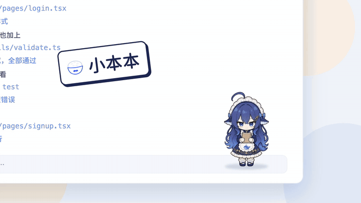

# 小本本（dsh-xiaobenben）

住在 DeepSeek Harness（dsh）右下角的鲸鱼娘，专翻你和 AI 的旧账：点她一下，她就说一件你和 agent 一起干过的真事——几点、哪件事、你的原话、干了多久、吃了几碗白饭。



*演示动画：界面是重画的，台词为演示编写。*

> 非官方插件，与 DeepSeek 无关。

**隐私**：第一次打开，小本本会问一次「让本肥鱼用你的模型写一批台词？」。**你同意后**，会把打过码的事件卡和事发前后的几句对话（你说的和 agent 回的，每件事不超过 300 字）发给你自己在 dsh 里配置的模型；发之前能看到样例、全文和预计 token，点「发送」才发。写好的台词存在本机，之后点她只从本机抽，不调模型；有了新的事，你点「更新台词」才再发一次。**不同意也能用**，台词来自本机模板，什么都不发；没配模型、模型调用失败时也是这样。「AI 年度回顾」同样是点了「发送」才发，它不发 agent 的回复。插件自己只在一种情况下联网：你点「放到桌面上」而本机没有 Electron 时，会下载一份（约 120 MB，默认走 npmmirror 镜像），不带任何你的数据。

另外还带一个「年度回顾」：过去一年你和各个 coding agent 做了什么、说了什么，导出分享图，见[下面](#年度回顾)。

## 安装

要先装 pnpm（`npm i -g pnpm`）。两种装法，任选一种：

**方法一：按名字装**

```sh
dsh plugin --profile web add dsh-xiaobenben
```

**方法二：让 dsh 自己装**。在 dsh 里发这句话：

> 给当前 dsh 安装 GitHub 上最新版本的「dsh-xiaobenben」插件

装完把 `dsh web` 关掉重开，右下角会出现小本本，左边栏会多出「年度回顾」。卸载用 `dsh plugin --profile web remove dsh-xiaobenben`。

上面两种都不行时，可以直接装打好的包：

```sh
dsh plugin --profile web add https://github.com/Kapozux/dsh-xiaobenben/releases/download/v0.2.1/dsh-xiaobenben-0.2.1.tgz
```

改代码时可以装本地目录（链接，改完 `pnpm run build` 再重开 dsh，不用重装）：

```sh
dsh plugin --profile web add ./dsh-xiaobenben
```

## 翻旧账

右下角的小本本鲸鱼娘：**左键点一下**，她就翻一件你和 agent 一起干过的真事——派的活干了多久、被你喊停、说好了却挨骂、认错、深夜加班、总账……
说完气泡底下有 3 个按钮：两个这一类的反应（点了她接一句）和「再翻一件」。抓起来能甩；右键有菜单：说哪一类、藏起私事、**放到桌面上**（关了网页也在）、先收起来。

「放到桌面上」目前只支持 macOS，要用 Electron 开一个透明窗口：本机有现成的（比如装过 dsh-pet）就直接用；没有会自动下载 Electron 43.3.0，下载时她会报进度，下完自己上桌面。镜像可以在插件配置的 `electronMirror` 或环境变量 `XBB_ELECTRON_MIRROR` 里换，也可以在 `electronPath` 里直接填一个 Electron.app 的路径。

事实（什么时候、在哪件事上、一句原话、多少分钟多少碗白饭）由程序从会话记录里判断、算出来；说法有两种：

- **你同意的话：模型写**。第一次打开她会问一次；也可以在右键菜单或「设置 → 年度回顾 → 翻旧账」里点「看看要发什么」。先给你看发出去的样例和全文、发给哪个模型、大概多少 token，点「发送」才发。一次批量写完：每件事写 5 个版本，再调一次模型挑出最好的一版，存在本机；之后点她只从本机抽，**不再调模型**。有了新的事，点「更新台词」才再发一次（只发新的）。
- **核对**：模型只管怎么说。写回来的每个版本先由程序核对——「」里的原话一字不差、数字都来自记录、最多两行不超过 60 字、没有行话——不过的扔掉，带着原因让模型重写一次。挑的那一步再查程序查不了的：主语有没有说反（谁派活、谁干活、谁说的话）、有没有编出记录里没有的细节。有问题的不选，都有问题的那件事照模板念。
- **角色设定**放在提示词里，全文见 [`docs/persona.md`](docs/persona.md)。
- **兜底：模板**。你说「不用」、没配模型、调用失败，或者某件事模型没写成，都照本机模板念（约 100 条，按事件分 30 多种，口气和模型写的一致）。这条路**不调模型，不发任何东西出去**。

台词的标准（最多两行 ≤60 字、有反差、有态度、原话逐字、数字真实）见 [`docs/lines-standard.md`](docs/lines-standard.md)。

健康、感情、成绩、家庭相关的不说，也不发。

她会轻轻上下浮、隔几秒眨一次眼，按台词换表情（开心冒♪、被吓到冒「！」、困了冒 z、害羞脸红、难过冒汗）。

### 素材与授权

- **立绘**（`assets/xiaobenben/`）：小本本鲸鱼娘，Kapozux 二创（AI 辅助，用 ChatGPT 的图像生成绘制），基于角色原型「溟月」（B 站 @上善无形）与女仆版设计（B 站 @ZipZipPipe），**CC BY-NC-SA 4.0**，见该目录的 `LICENSE` 和 `CREDITS.md`。往里放 `happy.png`、`sad.png` 这些同尺寸透明 PNG 就会换上真的表情图。
- **字体**（`assets/fonts/`）：思源柔黑 Resource Han Rounded（Cyano Hao，部分 © Adobe）的常用字子集，**SIL OFL 1.1**，见该目录的 `OFL.txt`。
- 插件代码：MIT（根目录 `LICENSE`）。

## 年度回顾

年度回顾：看过去一年你和各个 coding agent 一起做了什么、说了什么，导出分享图。

- **统计和原话在本机算**，不调模型、不花钱。
- **AI 部分可选**：用你自己的模型额度写 3 个年度关键词、3 个奖项和 150 字以内的「这一年」。点了才跑，跑之前先报价，你点「发送」才发。
- **导出**：竖版长图 + 一组 3:4 分页卡片，都在浏览器里画成 PNG，不出本机。

### 用法

1. 点左边栏「年度回顾」：统计和原话直接出来。
2. 想把 Claude Code / Codex / Cursor 的记录也算进去：**设置 → 年度回顾**，逐个勾选。每一项都写着会读哪个目录；只读，不上传。Cursor 的数据库会先复制一份再读，读完删掉。
3. 想要 AI 部分：点「看看要发什么」。报价页写明发给哪家、哪个模型，大概多少 token，要发的全文可以展开看。可以这一次单独换个模型，不改 dsh 的默认设置。点「发送」才发。结果存在本机，下次打开不重跑。
4. 在预览里隐藏不想放进图里的卡片，然后「下载长图」或「下载 3:4 卡片」。

对着 dsh **0.2.0-rc.2** 开发和测试。用到的每个 dsh API 都写在 [docs/dsh-api.md](docs/dsh-api.md) 里，带源码出处。

## 会发出去什么、不会发什么

只有你在确认框里点了「发送」，才会发给模型；发给的是你自己在 dsh 里配置的那个模型，插件没有自己的服务器。

「AI 年度回顾」发的只有这两样：

- 会话标题；
- 每月最多抽 30 句你自己说过的短句（200 字以内）。

「用你的模型写台词」发的是旧账的**事件卡**。每件事两部分。一是一行大白话：什么时候、在弄哪个项目（文件夹名或会话标题压出来的话题）、发生了什么（被抓包 / 被喊停 / 连着说了几回……）、数字（干了多久、几碗白饭、几回），以及你当时说的那一句（14 字以内；半截指令、带数字或英文的话不放进去）。二是**事发前后的几句对话原文**：上一轮你说的和 agent 回的各一句、这一轮各一句、你的下一句，每句截到 50～70 字，合起来不超过 300 字。总账类只有数（这 120 天几回、几天、几碗），没有对话。挑的那一步会把这些事件卡连同候选台词再发一次。发送前的确认框里能看到样例和要发的全文。标成私事的旧账（那一轮和它前后三轮）整件不发。

发之前都会打码（路径、邮箱、key、token、内网地址）。涉及健康、感情、成绩、家庭的句子默认不发。「AI 年度回顾」不发 agent 的回复；「用你的模型写台词」会发事发前后 agent 回的那一两句（见上）。

模型写回来的台词存在本机 dsh 数据目录的 `storages/dsh-xiaobenben/state.json` 里，「设置 → 年度回顾 → 翻旧账」里可以一键删掉、只念模板。

模型回来的内容里引用的原话，会回到发过去的材料里逐字核对，对不上的删掉。整份回顾最多调用 5 次模型，失败只重试 1 次，不循环，不开子代理。

## 卡片和版式

| | 你说的话 ≥200 句（完整版） | 不到 200 句（轻量版：少放数字，多放原话） |
|---|---|---|
| 封面 | 活跃天数、会话、句数、轮次 | 一句话总结 |
| 节奏 | 最长连续天数、最忙的月份、凌晨说话最多的一天（0–5 点之间消息最多的那天）、一天的时间分布 | — |
| 各 agent | 占比，不到 1% 合并成「其他」 | 不止一个 agent 时才有 |
| 最长的会话 | 有标题显示标题，没有就显示第一句的前 20 个字 | 同左 |
| 口头禅 | 去重后重复最多的短句 | 同左 |
| 全年第一句 / 凌晨最晚的一句 | 原样，带日期和来源 agent | 同左 |
| 平时说的话 | — | 全年等间隔挑几句 |
| AI：关键词 / 奖项 / 这一年 | 跑了才有 | 同左 |

- **没跑 AI 或 AI 失败**：AI 那几张卡不出现，剩下的照样拼成一张完整的图。
- **超长消息**：单条超过 2000 字的（贴代码、贴日志）不进原话候选。
- **敏感内容**：涉及健康、感情、成绩、家庭的原话，卡片上默认藏起来；整张卡就是那一句的话，整张默认隐藏。可以手动打开。
- **图底部**都写着「统计和原话都在本机算；AI 只读了你同意发送的那部分。」

## 配置（可选）

在 profile 的 `cordis.patch.yml`（例 `~/.dsh/profiles/web/cordis.patch.yml`）里写。注意 config 是整块替换，不是合并：

```yaml
- id: xiaobenben
  config:
    prices:            # dsh 的模型配置里没有价格；不填就只显示 token，不猜价
      - { provider: deepseek-official, model: deepseek-flash, input: 1, output: 2, currency: CNY }   # 每百万 token
    expensiveOutputPrice: 10      # 输出价格高于这个就提示「可以换便宜的模型」
    sensitiveExtra:               # 额外的敏感词
      健康: [某个词]
```

插件自己的状态（勾选了哪些来源、AI 结果缓存、隐藏了哪些卡）存在 `$DSH_HOME/storages/dsh-xiaobenben/state.json`，默认是 `~/.dsh/...`。

## 开发

```sh
pnpm install
npm test                 # 单元测试：统计、打码、原话逐字核对、报价、生成（假模型），不调真模型
npm run check:local      # 拿本机 ~/.claude 和 ~/.codex 跑整条链路：不跑 AI、AI 失败两种情况（假模型，不发任何东西）
pnpm run build           # 打包网页那一半 → lib/client.js
node scripts/write-light-home.mjs <目录>   # 把手造的轻度数据（只有 dsh、三个月、150 句）写成真的 dsh 会话，给单独的 DSH_HOME 用
```

- `src/core/`：统计、原话、打码、敏感、材料、AI，都不依赖 dsh。
- `src/sources/`：dsh（经 `ctx.sessionQuery`）、Claude Code、Codex、Cursor 的读取。
- `src/review.js`：把上面串起来。
- `src/index.js`：dsh host 入口，注册 `/api/xiaobenben.*` 路由。
- `src/client/`：网页那一半，包括左边栏图标、整页、设置页和 canvas 出图。
